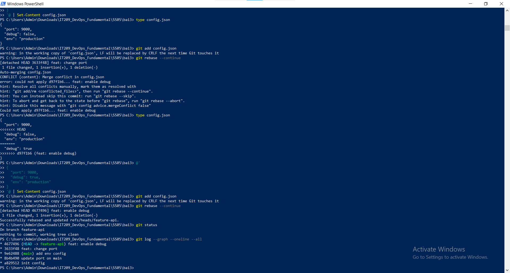

# Bài 3: Xử lý xung đột phức tạp trong quá trình Rebase

## 1. Mục tiêu

* Hiểu sự khác biệt giữa Merge và Rebase.
* Thực hành giải quyết conflict từng bước trong quá trình Rebase.
* Đưa lịch sử nhánh `feature-api` lên trên nhánh `main`.
* Không sử dụng merge thông thường để giải quyết conflict.

---

## 2. Thông tin bài thực hành

Nhánh chính:

```text
main
```

Nhánh tính năng:

```text
feature-api
```

File được sử dụng:

```text
config.json
```

---

## 3. Khởi tạo project

Khởi tạo Git repository:

```bash
git init
git branch -M main
```

Tạo file `config.json` ban đầu:

```json
{
  "port": 8080,
  "debug": false
}
```

Commit:

```bash
git add config.json
git commit -m "init config"
```

---

## 4. Tạo nhánh feature-api

```bash
git checkout -b feature-api
```

### Commit 1 trên feature

Thay đổi:

```json
{
  "port": 9000,
  "debug": false
}
```

Commit:

```bash
git add config.json
git commit -m "feat: change port"
```

### Commit 2 trên feature

Thay đổi:

```json
{
  "port": 9000,
  "debug": true
}
```

Commit:

```bash
git add config.json
git commit -m "feat: enable debug"
```

---

## 5. Tạo thay đổi mới trên main

Quay lại main:

```bash
git checkout main
```

### Commit 1 trên main

Thay đổi port:

```json
{
  "port": 8081,
  "debug": false
}
```

Commit:

```bash
git add config.json
git commit -m "update port on main"
```

### Commit 2 trên main

Thêm môi trường production:

```json
{
  "port": 8081,
  "debug": false,
  "env": "production"
}
```

Commit:

```bash
git add config.json
git commit -m "add env config"
```

---

## 6. Thực hiện Rebase

Chuyển về nhánh feature:

```bash
git checkout feature-api
```

Thực hiện:

```bash
git rebase main
```

Do cả `main` và `feature-api` cùng sửa `config.json`, Git phát sinh conflict trong quá trình áp dụng các commit của feature.

---

## 7. Conflict lần 1

Git phát hiện conflict khi áp dụng commit:

```text
feat: change port
```

Kiểm tra:

```bash
git status
```

File bị conflict:

```text
config.json
```

Mở file và giải quyết thủ công.

Phiên bản sau khi giải quyết:

```json
{
  "port": 9000,
  "debug": false,
  "env": "production"
}
```

Sau khi sửa:

```bash
git add config.json
```

Tiếp tục Rebase:

```bash
git rebase --continue
```

---

## 8. Conflict lần 2

Git tiếp tục áp dụng commit:

```text
feat: enable debug
```

Conflict tiếp tục xảy ra tại:

```text
config.json
```

Kiểm tra:

```bash
git status
```

Sau đó sửa thủ công và giữ lại cả thay đổi của `main` và `feature-api`.

Kết quả:

```json
{
  "port": 9000,
  "debug": true,
  "env": "production"
}
```

Sau khi giải quyết:

```bash
git add config.json
```

Tiếp tục:

```bash
git rebase --continue
```

Nếu Git yêu cầu xác nhận commit message thì giữ nguyên message và hoàn tất quá trình Rebase.

---

## 9. Kiểm tra sau khi Rebase

Kiểm tra trạng thái:

```bash
git status
```

Kết quả:

```text
On branch feature-api
nothing to commit, working tree clean
```

Kiểm tra file:

```bash
type config.json
```

Kết quả:

```json
{
  "port": 9000,
  "debug": true,
  "env": "production"
}
```

---

## 10. Kiểm tra lịch sử Git

Sử dụng:

```bash
git log --graph --oneline
```

Lịch sử mong muốn:

```text
* feat: enable debug
* feat: change port
* add env config
* update port on main
* init config
```

Các commit của `feature-api` nằm nối tiếp sau các commit mới nhất của `main`.

Không xuất hiện merge commit phụ.

---

## 11. Kết luận

Qua bài thực hành, đã thực hiện được:

* Tạo nhánh `feature-api`.
* Tạo hai commit thay đổi cùng file `config.json`.
* Tạo hai commit mới trên `main`.
* Thực hiện `git rebase main`.
* Giải quyết conflict lần thứ nhất.
* Tiếp tục Rebase bằng `git rebase --continue`.
* Giải quyết conflict lần thứ hai.
* Hoàn thành Rebase mà không sử dụng merge thông thường.
* Giữ lại các thay đổi cần thiết của cả `main` và `feature-api`.
* Đưa lịch sử `feature-api` lên trên `main` theo dạng tuyến tính.

---

## 12. Minh chứng Terminal

### Kiểm tra trạng thái trong quá trình Rebase

```bash
git status
```

Dán ảnh chụp màn hình tại đây.

### Conflict lần 1

Dán ảnh chụp `config.json` khi Git báo conflict lần 1 tại đây.

### Sau khi giải quyết conflict lần 1

```bash
git add config.json
git rebase --continue
```

Dán ảnh chụp màn hình tại đây.

### Conflict lần 2

Dán ảnh chụp `config.json` khi Git báo conflict lần 2 tại đây.

### Sau khi hoàn thành Rebase

```bash
git status
git log --graph --oneline
```

Dán ảnh chụp màn hình kết quả cuối cùng tại đây.
